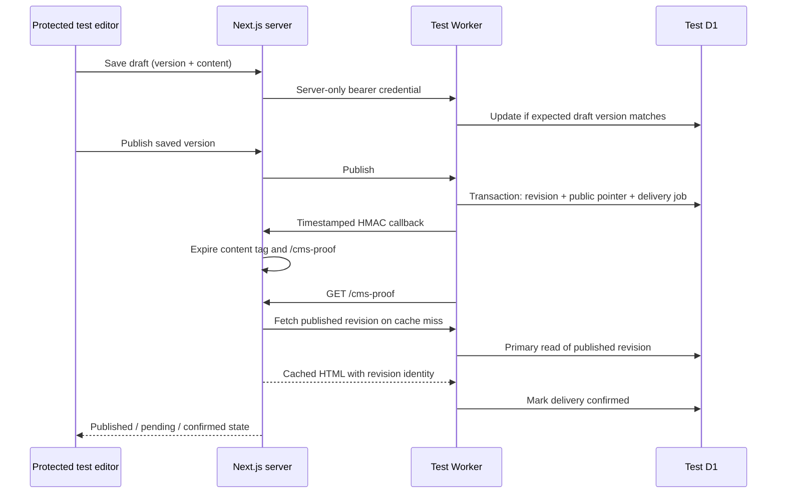

# CMS milestone 1: local draft-to-publication proof

## Scope and current status

### Cloud test setup: 2026-10-11

The `cms-testing` branch has a Ready Vercel Preview in project `breeze-full`, with Node 22 and `iad1` verified in deployment resources. After explicit approval, the separate `breeze-test-db` was created (ID `bc8cb3a4-bf92-4be6-82d0-84738ec3a381`, ENAM; D1 reported primary colo EWR), exported before migration into ignored `.local/`, and migrated. `breeze-test-api` is deployed at `https://breeze-test-api.nikodola.workers.dev`, bound only to this database. Its writes remain disabled. The seven CMS variables are saved only for Vercel Preview branch `cms-testing`; subsequent Preview builds receive them.

No automation bypass secret has been created. A temporary Preview-alias share credential was tested with the automation header, did not pass Vercel protection, and was revoked. Existing Vercel development OIDC access **did** reach the Preview (200) and was refused by the protected production deployment (403). See [CMS-PREVIEW-ACCESS.md](CMS-PREVIEW-ACCESS.md) for the recommended change to Next-owned invalidation and its retry tradeoff. That change is proposed, not implemented. Deployed publishing/performance measurements remain pending this decision. The local proof below still uses the original Worker callback flow.

This is one complete content workflow, with `/admin-test` as the editor and `/cms-proof` as the public test page. Existing Breeze pages, the homepage hero, forms, styles, and content files remain outside this workflow. The live dashboard-managed `breeze-api` Worker and `breeze-db` have not been modified. No cloud deployment or remote migration is part of the local test commands.

The original `home-hero` row is read through the existing public GET endpoint and copied into a separate test database. Its complete original JSON is retained in `cms_imports`; repeating the import never overwrites edits. The production schema cannot be inspected through that endpoint. Before any future live migration, inspect the real schema and export a backup with account access.

The existing images are bare filenames (`hero1.webp`, etc.), and the original button destination is `/contact` rather than the site's `/contact-us`. Import preserves these values. Images are retained as references but not displayed or editable in this text-only proof. The editor can change the button destination. R2 uploads are deliberately not part of this milestone.

## Stages implemented

| Stage | Result | Verification |
| --- | --- | --- |
| 1. Security and build repairs | Replaced the broken test page; removed fallback password, browser password storage, and filesystem write/upload APIs. Updated and pinned Next.js to 16.3.8 and refreshed vulnerable transitive packages. | Production build, dependency audit, authentication/CSRF tests. |
| 2. D1 and Worker | Additive tables, versioned drafts, immutable snapshots, atomic publication, durable delivery jobs. | Local Wrangler migration and real workerd/D1 integration tests. |
| 3. Thin editing workflow | Import one section, edit text and metadata, save draft, live preview, publish, refresh status, retry delivery. | Authenticated HTTP requests against a local production Next server. |
| 4. Cache proof | Tagged fetch + cached HTML; signed invalidation; warm exact URL and confirm revision. | Two publications without rebuilding/restarting; five cached requests make zero Worker content requests. |

Authentication here is a temporary test access gate, not the future client login system. Broader page migration, section layouts, image management, roles, and production admin access remain follow-up phases.

## Architecture



### Data model

The migration `workers/cms/migrations/0001_cms_workflow.sql` creates new namespaced tables. It contains no DROP, DELETE, ALTER, or UPDATE against existing tables.

| Table | Purpose |
| --- | --- |
| `cms_pages` | Stable ID, unique slug, page type and published revision pointer. |
| `cms_drafts` | Mutable schema-versioned JSON document and increasing edit version. |
| `cms_revisions` | Complete immutable document snapshot per published draft version. SQLite triggers forbid UPDATE and DELETE. |
| `cms_imports` | Original legacy JSON and provenance. |
| `cms_publish_outbox` | One job per revision, attempt count, retry time, lease, invalidation and HTML confirmation timestamps. |

This uses a single text section inside a versioned document for the proof. Later phases can introduce ordered sections and controlled layout types through schema-versioned validation. Do not turn arbitrary JSON into executable HTML or CSS.

All runtime SQL values use bound parameters. Publication uses a D1 batch transaction. The version condition is evaluated within that transaction, so a stale editor cannot overwrite a newer draft or publish a stale version. Retrying the same version reuses its revision. Failed outbox insertion rolls back the snapshot and publication pointer together.

### Routes

| Next.js route | Behavior |
| --- | --- |
| `/admin-test` | Protected test editor, dynamic, no-store, noindex. |
| `/admin` | Protected redirect to `/admin-test`. |
| `/api/cms/editor` | Authenticated server bridge. GET status; POST import, draft, publish or retry. |
| `/api/cms/revalidate` | HMAC-authenticated Worker callback with a five-minute timestamp window and fixed allowed page/tag. |
| `/cms-proof` | Only published revision; cached server-rendered HTML, noindex, no content loading skeleton. |
| `/api/admin`, `/api/admin/upload` | Retired: return 410; no filesystem modifications. |

Worker routes are `/api/public/pages/cms-proof` and `/api/admin/{proof,import,draft,publish,retry}`. The original Worker endpoint is not replaced or proxied by this Worker.

### Security boundaries

- Next test access requires an explicit enable flag, configured username, a random password of at least 32 characters, and a matching configured host. Requests are restricted to loopback locally or HTTPS on a Vercel **Preview** environment. `VERCEL_ENV=production` fails closed.
- Both Proxy and the actual editor page/API check authorization. The browser uses its HTTP Basic prompt; no password is put into application storage or client bundles.
- Browser mutations require the exact configured Origin and `x-cms-request: editor`. Bodies are capped while streaming, input is validated, and text renders through React escaping. URLs are limited to internal paths or HTTPS.
- Next sends a separate bearer token to the Worker. Worker writes require `CMS_ENVIRONMENT=test`, `CMS_WRITES_ENABLED=true` and the token. It refuses browser-origin admin requests. CORS is not authentication.
- Revalidation has its own HMAC secret. The signed exact body and timestamp cover a validated, fixed cache scope. Duplicate authenticated callbacks are harmless; old timestamps, tampered bodies and arbitrary paths are rejected.
- Preview content never enters the public loader. There is no draft fallback when a page is unpublished.
- The Worker configuration points exclusively to the approved `breeze-test-db`. For another client, replace its account/resource identifiers deliberately; never use the `breeze-db` production ID for this test.
- Basic auth is only a temporary test gate. Before production editing, replace it with authenticated sessions, authorization, audit identity and rate limiting. Do not promote a test preview deployment to production.

### Caching and delivery

The proof retains the current Next architecture without enabling Cache Components. Its server fetch explicitly uses `force-cache`, tag `cms:page:cms-proof`, and a one-hour fallback revalidation interval. The public route uses ISR. Draft/editor requests use `no-store`.

After the database commit, the Worker calls `revalidateTag(tag, { expire: 0 })` and `revalidatePath('/cms-proof')` through the signed endpoint. It then fetches the exact public URL and checks its revision ID/version. The public loader reads D1 through a `first-primary` session after a cache miss, avoiding stale replica refill.

`invalidated_at` means the callback acknowledged invalidation; `confirmed_at` means the public HTML exposed that revision or a later revision. These are different outcomes. A failed callback does not undo a committed publication. The stored job survives a Worker restart, uses a lease to avoid overlapping work, and retries with bounded backoff. The Worker cron checks every five minutes; the editor can retry immediately. Local `wrangler dev` does not automatically run the deployed cron schedule, so use the retry button locally.

There is no second Worker CDN JSON cache in this proof. The public Worker API returns `no-store`; Next's explicit server fetch cache owns content caching. A draft save never invalidates public content. Clients already holding an open page must navigate or reload to see a later publication; live push updates are outside scope.

## Run the automated local proof

From the repository root:

```powershell
npm ci
npm --prefix workers/cms ci
npm run cms:check
npm run cms:proof
```

`cms:check` tests SQLite preservation, immutability, atomic rollback, stale/racing edits, failed callbacks and retries, disabled production access, input validation, CSRF, and signatures. It uses real local workerd/D1, not a mocked SQL engine.

`cms:proof` makes **read-only GET requests** to the existing Cloudflare endpoint, including through the protected import action. It creates an isolated temporary D1 database, builds Next into `.next-cms-proof`, starts both servers on local loopback, performs two edit/publish cycles, and verifies rendered HTML and cache request counts. It creates random credentials only for that process, terminates its servers, and disposes its temporary database. It never calls Cloudflare management APIs or deploys anything. It requires network access for the legacy read and any uncached build resources.

Artifacts, ignored by Git:

- `.local/cms-proof-results.json`: measured timings and pass/fail evidence.
- `.local/cms-proof-build.log`: build and server output.
- `.local/cms-legacy-source.json`: original public source JSON for inspection.

The local timings are observations, not estimates of Vercel `iad1` performance. The test asserts correctness and zero origin reads on cache hits, not a hardcoded latency target. The `.next` directory used by ordinary development is separate from the proof build.

## Run the editor interactively

1. Install both dependency sets as above.
2. Copy `.env.example` to `.env.local` and `workers/cms/.dev.vars.example` to `workers/cms/.dev.vars`. Do not overwrite existing environment files; merge the settings if they already exist.
3. Generate **three independent** random values and assign them to `CMS_TEST_PASSWORD`, `CMS_WRITE_TOKEN`, and `CMS_REVALIDATE_SECRET`. A local generator for one value is:

   ```powershell
   node -e "console.log(require('node:crypto').randomBytes(32).toString('hex'))"
   ```

4. Set `CMS_TEST_ENABLED=true` in `.env.local`. Keep the shared write token and revalidation secret identical in both files. Use `CMS_TEST_ORIGIN=http://localhost:3000` in Next and `CMS_SITE_ORIGIN=http://localhost:3000` in the Worker. The Worker URL is `http://127.0.0.1:8787`. Hostnames and ports must match your browser's URL exactly.
5. Apply the migration **locally** and start the Worker:

   ```powershell
   npm --prefix workers/cms run migrate:local
   npm --prefix workers/cms run dev
   ```

6. In a second terminal, start Next:

   ```powershell
   npm run dev -- --hostname localhost
   ```

7. Open `http://localhost:3000/admin-test`, enter the configured username/password, and select **Copy existing D1 content**. Edit, save a draft, and publish it. Open `/cms-proof` to inspect the published text. For production cache measurements use `npm run cms:proof`; development HMR caching is not representative.

The Wrangler local database persists under `workers/cms/.wrangler/`. No R2 credentials or bucket are required. To disable the editor, set `CMS_TEST_ENABLED=false` and restart Next. Basic credentials can remain in the browser's auth cache until the browser session closes; use a private window for shared test machines.

## Cloudflare test deployment procedure

The initial resource creation, inspection/export, migration, and deployment below are complete. Do not repeat creation or overwrite the existing test database. Writes are still disabled pending the protected delivery decision described above.

1. Reuse the tested CMS Worker in `workers/cms/src/index.ts` as a **different** Worker named `breeze-test-api`. The original `breeze-api` was edited in the dashboard and its complete source has not been imported; export/download it before any future integration with that Worker.
2. After explicit confirmation, create a separate D1 database named `breeze-test-db` (US East location hint `enam` when available). Record its ID. Put only this ID into `workers/cms/wrangler.jsonc`. Keep the binding name `DB`; never bind this test Worker to `breeze-db`.
3. From `workers/cms`, authenticate Wrangler to the intended account. Inspect the target database before applying migrations:

   ```powershell
   npx wrangler d1 execute DB --remote --file sql/inspect.sql
   npx wrangler d1 export DB --remote --output ../../.local/breeze-test-before.sql
   npx wrangler d1 migrations list DB --remote
   npx wrangler d1 migrations apply DB --remote
   ```

   These are future **remote** steps for the separate test database. Inspect a fresh or existing schema, confirm the database ID, and retain the export. Do not point these commands at production without a separate review.

4. Configure Worker secrets (interactive commands avoid secrets in shell history):

   ```powershell
   npx wrangler secret put CMS_WRITE_TOKEN
   npx wrangler secret put CMS_REVALIDATE_SECRET
   ```

5. Keep writes disabled for the first deployment. Add `CMS_SITE_ORIGIN` to Worker vars using the exact stable Vercel preview origin. Deploy with `npx wrangler deploy`. After the Next preview and its secrets are configured, set the Worker var `CMS_WRITES_ENABLED` to `true` and redeploy this **test Worker only**.
6. Confirm the cron trigger is present. Use the editor to import the one existing public row. No cloning, editing, or deletion of production rows is required.

## Vercel Preview configuration

The variables below have been configured for `cms-testing`. The broad automation-secret option later in this section is **not approved** and has not been enabled. Prefer the OIDC/Next-owned approach in [CMS-PREVIEW-ACCESS.md](CMS-PREVIEW-ACCESS.md).

The local directory is `breeze-web`; the connected Vercel project is **`breeze-full`**, in `nikodolas-projects`, connected to `NikoDola/breeze-full`. Use the **`cms-testing`** branch and its stable preview alias. Set the following variables for **Preview only, scoped to `cms-testing`**. No `NEXT_PUBLIC_` names:

| Variable | Value |
| --- | --- |
| `CMS_TEST_ENABLED` | `true` |
| `CMS_TEST_ORIGIN` | Exact HTTPS preview origin without trailing slash, matching the address used in the browser |
| `CMS_WORKER_URL` | New `breeze-test-api` HTTPS Worker origin, not the existing `breeze-api` origin |
| `CMS_TEST_USERNAME` | Test editor username |
| `CMS_TEST_PASSWORD` | Random test-only password, at least 32 characters |
| `CMS_WRITE_TOKEN` | Same value as the test Worker's secret |
| `CMS_REVALIDATE_SECRET` | Same independent value as the test Worker's secret |

Leave `CMS_LOCAL_PROOF_BUILD` unset on Vercel. Vercel supplies its own `VERCEL` and `VERCEL_ENV` values. Do not override them or enable CMS variables for Production. Build the preview after its configuration is set; the test page can return 404 until first publication, then on-demand revalidation refreshes it.

Enable Vercel Deployment Protection for the preview as an additional gate. If it protects the callback and public proof URL, create an automation bypass secret and set `VERCEL_AUTOMATION_BYPASS_SECRET` as a **Worker secret**. The Worker passes it in a header to both requests. The bypass does not replace the app's HMAC or editor authorization. Never put the bypass in a query string or client code.

The `cms-testing` branch includes `vercel.json` with `regions: ["iad1"]` for US East Node functions and ISR. It does not change `main` or the production deployment. Next.js 16.3.8 deprecates route-level `preferredRegion`, so placement uses Vercel configuration. The package pins Node 22.x. Verify actual function placement in the Preview deployment before measuring; CDN ingress location is not proof of function location. Use one exact deployment/alias for the editor, callbacks and measured page; refreshing a different deployment's cache will not prove this workflow.

Acceptance on Vercel: record the deployment ID, publish twice through `/admin-test`, confirm each returned revision in `/cms-proof` HTML, inspect cache-hit headers and Worker request logs, and verify the deployment ID stayed unchanged. Measure API latency, first rendering, warmed delivery and publish-to-visible time separately. Local success does not establish Vercel latency or deployed invalidation behavior; this remains the next environment-specific gate.

## Before extending beyond the proof

- Review the actual dashboard Worker source and live D1 schema before integration. Do not infer schema from the public JSON response.
- Confirm R2 bucket bindings, image delivery domain and access policy before enabling uploads.
- For image tests, create a separate `breeze-test-assets` R2 bucket only after that phase is approved. Do not bind or change production storage; no R2 bucket is needed for the current text workflow.
- Add real user identity and authorization before production administration; establish backup/export retention and a restore drill.
- Add content types, controlled section layouts and migration mappings one page at a time. Preserve developer-controlled hero/form components.

References used: [Next ISR](https://nextjs.org/docs/app/guides/incremental-static-regeneration), [revalidateTag](https://nextjs.org/docs/app/api-reference/functions/revalidateTag), [D1 transactional batches](https://developers.cloudflare.com/d1/worker-api/d1-database/), [D1 migrations](https://developers.cloudflare.com/d1/reference/migrations/), [Vercel automation bypass](https://vercel.com/docs/deployment-protection/methods-to-bypass-deployment-protection/protection-bypass-automation). Framework code was checked against the locally installed Next 16.3 documentation.
