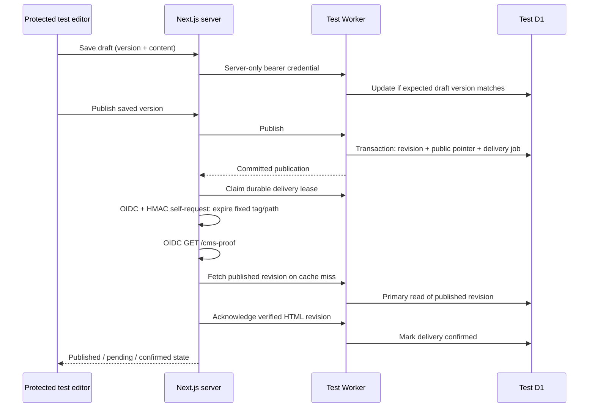

# CMS milestone 1: local draft-to-publication proof

## Scope and current status

### Cloud test setup: 2026-10-11

Current deployed evidence and remaining browser acceptance are recorded in
[CMS-PREVIEW-RESULTS.md](CMS-PREVIEW-RESULTS.md).

The `cms-testing` branch has a Ready Vercel Preview in project `breeze-full`, with Node 22 and `iad1` verified in deployment resources and the running function. After explicit approval, the separate `breeze-test-db` was created (ID `bc8cb3a4-bf92-4be6-82d0-84738ec3a381`, ENAM; D1 reported primary colo EWR), exported before migration into ignored `.local/`, and migrated. `breeze-test-api` is deployed at `https://breeze-test-api.nikodola.workers.dev`, bound only to this database. Test writes were enabled after the deployed, read-only security preflight passed with writes disabled. The checked-in default remains disabled. The seven CMS variables are saved only for Vercel Preview branch `cms-testing`; subsequent Preview builds receive them.

No automation bypass secret has been created. A temporary Preview-alias share credential was tested with the automation header, did not pass Vercel protection, and was revoked. Existing Vercel development OIDC access **did** reach the Preview (200) and was refused by the protected production deployment (403). See [CMS-PREVIEW-ACCESS.md](CMS-PREVIEW-ACCESS.md) for the recommended change to Next-owned invalidation and its retry tradeoff. Next-owned delivery is now implemented with OIDC verification. Remote results are recorded separately after the Preview acceptance run. No project-wide bypass credential is used.

This is one complete content workflow, with `/admin-test` as the editor and `/cms-proof` as the public test page. Existing Breeze pages, the homepage hero, forms, styles, and content files remain outside this workflow. The live dashboard-managed `breeze-api` Worker and `breeze-db` have not been modified. No cloud deployment or remote migration is part of the local test commands.

The original `home-hero` row is read through the existing public GET endpoint and copied into a separate test database. Its complete original JSON is retained in `cms_imports`; repeating the import never overwrites edits. The production schema cannot be inspected through that endpoint. Before any future live migration, inspect the real schema and export a backup with account access.

The existing images are bare filenames (`hero1.webp`, etc.), and the original button destination is `/contact` rather than the site's `/contact-us`. Import preserves these values. The visual editor can now select existing site images, edit image references, reorder/remove them, and preview a single image or slider. Missing legacy files display an unavailable placeholder; references are never silently replaced. The editor can change the button destination. R2 uploads remain outside this milestone. See [CMS-VISUAL-EDITOR.md](CMS-VISUAL-EDITOR.md).

## Stages implemented

| Stage | Result | Verification |
| --- | --- | --- |
| 1. Security and build repairs | Replaced the broken test page; removed fallback password, browser password storage, and filesystem write/upload APIs. Updated and pinned Next.js to 16.3.8 and refreshed vulnerable transitive packages. | Production build, dependency audit, authentication/CSRF tests. |
| 2. D1 and Worker | Additive tables, versioned drafts, immutable snapshots, atomic publication, durable delivery jobs. | Local Wrangler migration and real workerd/D1 integration tests. |
| 3. Thin editing workflow | Import one section, edit text and metadata, save draft, live preview, publish, refresh status, retry delivery. | Authenticated HTTP requests against a local production Next server. |
| 4. Cache proof | Tagged fetch + cached HTML; signed invalidation; warm exact URL and confirm revision. | Two publications without rebuilding/restarting; five cached requests make zero Worker content requests. |

Authentication here is a temporary test access gate, not the future client login system. Broader page migration, section layouts, image management, roles, and production admin access remain follow-up phases.

## Architecture



### Data model

Migration `0001_cms_workflow.sql` creates namespaced CMS tables without changing legacy tables. Additive migration `0002_next_delivery.sql` adds a lease token to the outbox; it retains every existing row.

| Table | Purpose |
| --- | --- |
| `cms_pages` | Stable ID, unique slug, page type and published revision pointer. |
| `cms_drafts` | Mutable schema-versioned JSON document and increasing edit version. |
| `cms_revisions` | Complete immutable document snapshot per published draft version. SQLite triggers forbid UPDATE and DELETE. |
| `cms_imports` | Original legacy JSON and provenance. |
| `cms_publish_outbox` | One job per revision, attempt count, retry time, lease, invalidation and HTML confirmation timestamps. |

This uses a single text section inside a versioned document for the proof. Later phases can introduce ordered sections and controlled layout types through schema-versioned validation. Do not turn arbitrary JSON into executable HTML or CSS.

All runtime SQL values use bound parameters. Publication uses a D1 batch transaction. The version condition is evaluated within that transaction, so a stale editor cannot overwrite a newer draft or publish a stale version. Retrying the same version reuses its revision. Failed outbox insertion rolls back the snapshot and publication pointer together.

### Routes

| Next.js route | Behavior |
| --- | --- |
| `/admin-test` | Protected test editor, dynamic, no-store, noindex. |
| `/admin` | Protected redirect to `/admin-test`. |
| `/api/cms/editor` | Authenticated server bridge. GET status; POST import, draft, publish, retry, or read-only security preflight. |
| `/api/cms/revalidate` | Next-owned HMAC endpoint with a five-minute timestamp window, fixed Preview host/page/tag, and no production access. Its secret is never provided to the Worker. |
| `/cms-proof` | Only published revision; cached server-rendered HTML, noindex, no content loading skeleton. |
| `/api/admin`, `/api/admin/upload` | Retired: return 410; no filesystem modifications. |

Worker routes are `/api/public/pages/cms-proof` and `/api/admin/{health,proof,import,draft,publish,delivery/claim,delivery/ack}`. The original Worker endpoint is not replaced or proxied by this Worker.

### Security boundaries

- Next test access requires an explicit enable flag, configured username, a random password of at least 32 characters, and a matching configured host. Requests are restricted to loopback locally or HTTPS on a Vercel **Preview** environment. `VERCEL_ENV=production` fails closed. On Vercel, the branch must be `cms-testing`, the origin must be its pinned branch alias, and the Worker URL must be the pinned test Worker.
- Both Proxy and the actual editor page/API check authorization. The browser uses its HTTP Basic prompt; no password is put into application storage or client bundles.
- Browser mutations require the exact configured Origin and `x-cms-request: editor`. Bodies are capped while streaming, input is validated, and text renders through React escaping. URLs are limited to internal paths or HTTPS.
- Next sends a separate bearer token to the Worker. Worker writes require `CMS_ENVIRONMENT=test`, `CMS_WRITES_ENABLED=true` and the token. It refuses browser-origin admin requests. CORS is not authentication.
- Revalidation has its own HMAC secret. The signed exact body and timestamp cover a validated, fixed cache scope. Duplicate authenticated Next requests are harmless; old timestamps, tampered bodies and arbitrary paths are rejected.
- Unpublished draft content never enters the public loader. There is no draft fallback when a page is unpublished.
- The Worker configuration points exclusively to the approved `breeze-test-db`. For another client, replace its account/resource identifiers deliberately; never use the `breeze-db` production ID for this test.
- Basic auth is only a temporary test gate. Before production editing, replace it with authenticated sessions, authorization, audit identity and rate limiting. Do not promote a test preview deployment to production.

### Caching and delivery

The proof retains the current Next architecture without enabling Cache Components. Its server fetch explicitly uses `force-cache`, tag `cms:preview:cms-testing:page:cms-proof`, and a one-hour fallback revalidation interval. The public route uses ISR. React `cache` shares its loader between metadata and page rendering even with the fetch timeout signal. Draft/editor requests use `no-store`.

After committing D1, Next claims a 90-second lease through the authenticated Worker. It obtains the current request's short-lived Preview identity using `getVercelOidcToken()` and sends OIDC plus a Next-only HMAC to its fixed `/api/cms/revalidate` endpoint. That separate request calls `revalidateTag(tag, { expire: 0 })` and `revalidatePath('/cms-proof')`, allowing invalidation to finish before HTML verification. Next then warms the fixed public URL using OIDC and checks the immutable revision ID/version. Redirects are forbidden; tokens never go to the Worker. The public loader uses a `first-primary` D1 session after a cache miss.

`invalidated_at` records successful invalidation; `confirmed_at` records matching HTML (or a newer revision). Failure preserves the committed publication and a durable retry record. Each claim gets a unique lease token; stale or overlapping attempts cannot acknowledge another invocation. Interrupted leases expire after 90 seconds. Failures record a fixed safe message and bounded exponential backoff (30 seconds to one hour). The authenticated **Retry cache refresh** button can bypass backoff but cannot steal an active lease. Retry never inserts a revision. A newer confirmed revision fulfills older jobs.

There is **no unattended retry runner in this milestone**. The Worker has no cron or outgoing Vercel requests. An editor can refresh status and retry after interruption; a future trusted Preview OIDC runner can use the same protected endpoint. Vercel Cron targets production, so it is unsuitable for this Preview. Do not describe manual recovery as automatic background delivery.

There is no second Worker CDN JSON cache in this proof. The public Worker API returns `no-store`; Next's explicit server fetch cache owns content caching. A draft save never invalidates public content. Clients already holding an open page must navigate or reload to see a later publication; live push updates are outside scope.

## Run the automated local proof

From the repository root:

```powershell
npm ci
npm --prefix workers/cms ci
npm run cms:check
npm run cms:proof
```

`cms:check` tests SQLite preservation, immutability, atomic rollback, stale/racing edits, failed callbacks and retries, disabled production access, input validation, CSRF, and signatures. It uses real local workerd/D1, not a mocked SQL engine.

`cms:proof` makes **read-only GET requests** to the existing Cloudflare endpoint, including through the protected import action. It creates an isolated temporary D1 database, builds Next into `.next-cms-proof`, starts both servers on local loopback, performs two edit/publish cycles, and verifies rendered HTML and cache request counts. It creates random credentials only for that process, terminates its servers, and disposes its temporary database. It never calls Cloudflare management APIs or deploys anything. It requires network access for the legacy read and any uncached build resources.

Artifacts, ignored by Git:

- `.local/cms-proof-results.json`: measured timings and pass/fail evidence.
- `.local/cms-proof-build.log`: build and server output.
- `.local/cms-legacy-source.json`: original public source JSON for inspection.

The local timings are observations, not estimates of Vercel `iad1` performance. The test asserts correctness and zero origin reads on cache hits, not a hardcoded latency target. The `.next` directory used by ordinary development is separate from the proof build.

## Run the editor interactively

1. Install both dependency sets as above.
2. Copy `.env.example` to `.env.local` and `workers/cms/.dev.vars.example` to `workers/cms/.dev.vars`. Do not overwrite existing environment files; merge the settings if they already exist.
3. Generate **three independent** random values and assign them to `CMS_TEST_PASSWORD`, `CMS_WRITE_TOKEN`, and `CMS_REVALIDATE_SECRET`. A local generator for one value is:

   ```powershell
   node -e "console.log(require('node:crypto').randomBytes(32).toString('hex'))"
   ```

4. Set `CMS_TEST_ENABLED=true` in `.env.local`. Keep only `CMS_WRITE_TOKEN` identical in both files. `CMS_REVALIDATE_SECRET` stays only in Next. Use `CMS_TEST_ORIGIN=http://localhost:3000` in Next and `CMS_UPLOAD_ORIGIN=http://localhost:3000` in the Worker's `.dev.vars`. The Worker URL is `http://127.0.0.1:8787`. Hostnames and ports must match your browser's URL exactly. See `CMS-MEDIA.md` for local media setup and recovery.
5. Apply the migration **locally**:

   ```powershell
   npm --prefix workers/cms run migrate:local
   ```

6. Start the website and local Worker together from the repository root. The launcher waits for the Worker before starting Next; Ctrl+C stops both:

   ```powershell
   npm run dev -- --hostname localhost
   ```

7. Open `http://localhost:3000/admin-test`, enter the configured username/password, and select **Copy existing D1 content**. Edit, save a draft, and publish it. Open `/cms-proof` to inspect the published text. For production cache measurements use `npm run cms:proof`; development HMR caching is not representative.

The Wrangler local database persists under `workers/cms/.wrangler/`. No R2 credentials or bucket are required. To disable the editor, set `CMS_TEST_ENABLED=false` and restart Next. Basic credentials can remain in the browser's auth cache until the browser session closes; use a private window for shared test machines.

## Cloudflare test deployment procedure

The initial resource creation, inspection/export, migration, and deployment below are complete. Do not repeat creation or overwrite the existing test database. Deploy initially with writes disabled. Enable them only after the read-only preflight described below passes.

1. Reuse the tested CMS Worker in `workers/cms/src/index.ts` as a **different** Worker named `breeze-test-api`. The original `breeze-api` was edited in the dashboard and its complete source has not been imported; export/download it before any future integration with that Worker.
2. After explicit confirmation, create a separate D1 database named `breeze-test-db` (US East location hint `enam` when available). Record its ID. Put only this ID into `workers/cms/wrangler.jsonc`. Keep the binding name `DB`; never bind this test Worker to `breeze-db`.
3. From `workers/cms`, authenticate Wrangler to the intended account. Inspect the target database before applying migrations:

   ```powershell
   npx wrangler d1 execute DB --remote --file sql/inspect.sql
   npx wrangler d1 export DB --remote --output ../../.local/breeze-test-before.sql
   npx wrangler d1 migrations list DB --remote
   npx wrangler d1 migrations apply DB --remote
   ```

   These are future **remote** steps for the separate test database. Inspect a fresh or existing schema, confirm the database ID, and retain the export. Do not point these commands at production without a separate review.

4. Configure Worker secrets (interactive commands avoid secrets in shell history):

   ```powershell
   npx wrangler secret put CMS_WRITE_TOKEN
   ```

5. Keep `CMS_WRITES_ENABLED=false` for the first deployment. Deploy the test Worker, then configure and deploy the Next Preview. Call authenticated `POST /api/cms/editor` with `{ "action": "preflight" }`. It verifies Worker credentials, migration, environment, and a signed dry-run Next request through Preview OIDC while writes remain off.
6. After preflight succeeds and unauthenticated/cross-origin mutation checks fail, deploy this **test Worker only** with `--var CMS_WRITES_ENABLED:true`. Keep the checked-in default false. Confirm the deployed binding is the test database and the only Worker secret is `CMS_WRITE_TOKEN`. Use the editor to import the original public row. No production writes or R2 resources are involved.

## Vercel Preview configuration

The variables below are scoped to `cms-testing`. No Vercel automation bypass secret is created or permitted in the Worker. See [CMS-PREVIEW-ACCESS.md](CMS-PREVIEW-ACCESS.md) for the access investigation.

The local directory is `breeze-web`; the connected Vercel project is **`breeze-full`**, in `nikodolas-projects`, connected to `NikoDola/breeze-full`. Use the **`cms-testing`** branch and its stable preview alias. Set the following variables for **Preview only, scoped to `cms-testing`**. No `NEXT_PUBLIC_` names:

| Variable | Value |
| --- | --- |
| `CMS_TEST_ENABLED` | `true` |
| `CMS_TEST_ORIGIN` | Exact HTTPS preview origin without trailing slash, matching the address used in the browser |
| `CMS_WORKER_URL` | New `breeze-test-api` HTTPS Worker origin, not the existing `breeze-api` origin |
| `CMS_TEST_USERNAME` | Test editor username |
| `CMS_TEST_PASSWORD` | Random test-only password, at least 32 characters |
| `CMS_WRITE_TOKEN` | Same value as the test Worker's secret |
| `CMS_REVALIDATE_SECRET` | Independent Next-only HMAC value; absent from the Worker |

Leave `CMS_LOCAL_PROOF_BUILD` unset on Vercel. Vercel supplies its own `VERCEL` and `VERCEL_ENV` values. Do not override them or enable CMS variables for Production. Build the preview after its configuration is set; the test page can return 404 until first publication, then on-demand revalidation refreshes it.

Keep Vercel Deployment Protection and OIDC Federation enabled. Default Trusted Sources self-access allows Preview-to-Preview and development-to-Preview, without either reaching production. Do not add any Preview-to-production rule. The application additionally pins the exact `cms-testing` alias and branch. No automation bypass secret, domain exception, or broad trust rule is needed. Local test scripts load their development OIDC identity from an ignored environment file; Vercel Functions get their current Preview token from the runtime request context.

The `cms-testing` branch includes `vercel.json` with `regions: ["iad1"]` for US East Node functions and ISR. It does not change `main` or the production deployment. Next.js 16.3.8 deprecates route-level `preferredRegion`, so placement uses Vercel configuration. The package pins Node 22.x. Verify actual function placement in the Preview deployment before measuring; CDN ingress location is not proof of function location. Use one exact deployment/alias for the editor, callbacks and measured page; refreshing a different deployment's cache will not prove this workflow.

Acceptance on Vercel: record the deployment ID, publish through the same protected editor API used by `/admin-test`, confirm each returned revision in `/cms-proof` HTML, inspect cache-hit headers and Worker request logs, and verify the deployment ID stayed unchanged. Measure API latency, first rendering, warmed delivery and publish-to-visible time separately. Local measurements do not establish Vercel latency.

## Before extending beyond the proof

### Preview acceptance and measurements

Load the seven branch-specific CMS settings into ignored `.local/cms-preview.env`.
Use Vercel CLI to obtain a development OIDC token in ignored `.env.local`; never commit it.

```powershell
# While Worker writes are still false: verifies credentials, OIDC, iad1 and guards.
npm run cms:preview-proof
# After the preflight and explicit test Worker enablement:
npm run cms:preview-workflow
# Alternative standard HTTP client if Vercel challenges Node's TLS client:
node --env-file=.local/cms-preview.env --env-file=.env.local workers/cms/tests/preview-proof.mjs --allow-test-writes --transport=curl
```

The second command modifies only the isolated proof page. It tests draft privacy,
duplicate publication, interrupted delivery recovery, 30 direct Worker requests,
30 invalidated Next page requests, 50 cached requests, and 10 publication cycles.
It restores the test document afterward. Record the Vercel deployment ID before
and after to confirm no redeployment. An authenticated Wrangler tail records
sanitized request counts; raw request headers and secrets are never saved.
The direct API phase compares the tail against 30 actual requests and records whether calibration passed. Live logs can drop events even without a client sampling filter: an incomplete calibration is reported, not treated as proof of exact counts or an application failure. Origin samples are spaced 1.2 seconds apart; these waits are excluded from latency. Probe paths avoid UUIDs because Cloudflare redacts UUID-shaped URL segments in logs. Cache HIT headers, local origin-count assertions, and calibrated logs provide separate evidence. Counts are observed test-window events, not account-wide billing totals.
Reports under `.local/` contain samples, median and nearest-rank p95, cache headers,
and request counts. Timings are full HTTP response times from the machine running
the test, including its network distance; uncached samples are regenerated pages,
not measurements of every possible cold-start condition.

The curl transport includes a fresh HTTPS connection in each measured response;
Node fetch normally reuses connections. Do not mix these transports into one
latency sample. `--cached-samples=50` and `--request-gap-ms=1500` control the
cached sample count and pacing (waits are excluded from timing). The optional
`--resume-measurements` reuses completed Worker/uncached samples from the ignored
report; use it only on the same verified deployment and with the same transport.
It retains interrupted attempts. Vercel security-checkpoint responses are test
interruptions, never cache successes. Do not disable project protection or create
a broad automation credential to make a benchmark pass.
If the core workflow completes but checkpoint responses occur, the harness
reports `workflow-passed-with-checkpoint-warnings` and exits with code 2.

### Next milestone

- Review the actual dashboard Worker source and live D1 schema before integration. Do not infer schema from the public JSON response.
- Confirm R2 bucket bindings, image delivery domain and access policy before enabling uploads.
- For image tests, create a separate `breeze-test-assets` R2 bucket only after that phase is approved. Do not bind or change production storage; no R2 bucket is needed for the current text workflow.
- Add real user identity and authorization before production administration; establish backup/export retention and a restore drill.
- Add content types, controlled section layouts and migration mappings one page at a time. Preserve developer-controlled hero/form components.

References used: [Next ISR](https://nextjs.org/docs/app/guides/incremental-static-regeneration), [revalidateTag](https://nextjs.org/docs/app/api-reference/functions/revalidateTag), [D1 transactional batches](https://developers.cloudflare.com/d1/worker-api/d1-database/), [D1 migrations](https://developers.cloudflare.com/d1/reference/migrations/), [Vercel Trusted Sources](https://vercel.com/docs/deployment-protection/methods-to-bypass-deployment-protection/trusted-sources). Framework code was checked against the locally installed Next 16.3 documentation.
